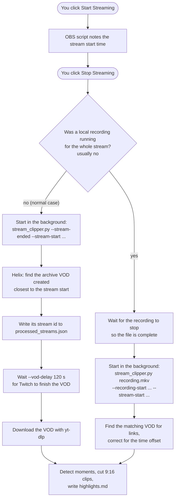

# Auto-clip flow

**Goal:** when you stop streaming in OBS, the stream gets clipped automatically with no other action from you. Clips land in `CLIPPER_OUT/<date>/` (default `~/Videos/StreamClips`). Nothing is ever uploaded: you review the clips and post the ones you like.

**The trigger is an OBS script.** Everything runs on your PC; no server is needed.

> The diagrams are [Mermaid](https://mermaid.js.org/). They render on GitHub, in VS Code with the "Markdown Preview Mermaid Support" extension, in Obsidian, or by pasting the code block into <https://mermaid.live>.

---

## The flow

### Why the OBS script and the clipper are two processes

OBS runs Python scripts **inside the OBS process**. Clipping takes minutes (downloading GBs, decoding the whole audio track, encoding clips, maybe Whisper). Doing that inside OBS would freeze or lag OBS, a crash in ffmpeg/numpy could take OBS down with it, and closing OBS would kill the clipping halfway.

So `obs/stream_clipper_obs.py` is only the **trigger**. It reacts to OBS events and starts the same `stream_clipper.py` used for manual runs as a separate background process (no window), which keeps running even if OBS is closed. There is one clipper; OBS just decides *when* it runs.

### Step by step (normal case: no recording)

1. **Stream starts:** the script remembers the time.
2. **Stream stops:** the script starts `python stream_clipper.py --stream-ended --stream-start <time>`, plus any extra flags from its settings. Output goes to `~/.cache/stream_clipper/obs.log`.
3. **Find the VOD:** Helix `/videos?type=archive`. Twitch lists the archive as soon as a stream starts, so it's there immediately. The one whose `created_at` is closest to the stream start (within 10 min) is picked.
4. **Claim it:** the stream id goes into `processed_streams.json` right away, so a second run (or pressing the test button afterwards) won't clip it again.
5. **Wait** `--vod-delay` (120 s) for Twitch to finish the VOD.
6. **Clip:** yt-dlp download into `CACHE_DIR`, then audio analysis, picking moments, ffmpeg cuts, and `highlights.md` / `.json`.

Clips usually show up **about 5–15 minutes** after the stream, mostly spent downloading.

### Optional: when there's a local recording

If OBS was also recording, **and that recording covers the whole stream** (it was running when the stream started, or started within 60 s of it), the local file is used instead of the VOD:

- The script waits for the recording to stop (with OBS's auto-record, a second after the stream stops), because the file isn't usable until it's finished.
- No download, and no Twitch music muting. Twitch mutes VOD sections with copyrighted music, which hides moments from the audio detection.
- Quality is only better than the VOD if the recording uses higher settings than the stream ("Same as stream" gives the same quality).
- The clipper still finds the VOD and stores `vod_offset` (*VOD time = recording time − offset*). Twitch links, `--markers` and `--chat` then point to the right moment. Clip names, the "Time" column and `--at` stay in recording time.
- The date folder uses the recording **start** time.

A recording that was stopped or started mid-stream is incomplete, so the VOD is used then. This can be turned off with *Use the local recording if it covers the whole stream* in the script settings.

### Setup (once)

1. **Packages in a venv:** `python -m venv .venv` in the project folder, then install with `.venv\Scripts\python -m pip install -e .` (add `".[captions]"` for `--captions`). See the README for other shells. If the folder is synced by OneDrive/Dropbox, mark `.venv` as "always keep on this device".
2. **Python for OBS:** Tools → Scripts → *Python Settings* → point it to a regular 64-bit Python install (on Windows typically `C:\Users\<you>\AppData\Local\Programs\Python\Python3xx`), not the venv. OBS loads Python's DLL from there, and a venv doesn't contain it. The OBS script only uses the standard library.
3. **Load the script:** Tools → Scripts → **+** → `obs/stream_clipper_obs.py`.
4. **`.env`:** `TWITCH_CHANNEL`, `TWITCH_CLIENT_ID` and `TWITCH_CLIENT_SECRET` are required to find the VOD.
5. **Twitch:** **Store past broadcasts** must be on.
6. **Test:** press **Clip latest VOD now** in the script settings. It clips the newest VOD right away, with no wait, and marks it as done. Then check `obs.log`.

**Which Python runs the clipper:** the one set in the script settings; else `<project>\.venv`; else `%USERPROFILE%\.venvs\stream_clipper`; else OBS's own Python. The Script Log prints the choice when the script loads.

Script settings: on/off, use the local recording, path to `stream_clipper.py`, Python (empty = auto, as above), extra flags (for example `--captions --lang fr`), the log file, and the two test buttons.

### Limits

- If the script is (re)loaded **during** a stream, it misses the start time. The newest VOD is then used, which is still the right one in practice.
- Downloaded VODs stay in `CACHE_DIR` unless `--delete-vod` is in the extra flags. Local recordings are never deleted.
- With a local recording, only the first audio track is analysed. With multi-track recording, keep track 1 as the full mix.

---

## Failure handling

| Situation | Behaviour |
|---|---|
| Clipping fails (download, ffmpeg...) | `error: ...` in `obs.log`. The stream stays marked as done and isn't retried. Re-run by hand: `python stream_clipper.py <VOD URL>`. |
| No VOD found / no `TWITCH_CHANNEL` | `error: ...` in `obs.log`, exits. Check "Store past broadcasts" and `.env`. |
| Missing Python packages | Traceback in `obs.log`. Check which Python the Script Log says it uses, and run `pip install -e .` with that one (normally the venv). |
| Clipper can't be started (Python or path wrong) | A line in OBS's Script Log. Fix it in the script settings. |
| Local recording, but no VOD match | Clips are made anyway, without Twitch links. |

## Files

| File | Purpose |
|---|---|
| `~/.cache/stream_clipper/obs.log` | Output of every OBS-triggered run, with a `=====` header per run |
| `CACHE_DIR/processed_streams.json` | Stream ids already clipped. Delete an id to allow it again. |
| `CACHE_DIR/<vod_id>.mp4` | Downloaded VOD (`--delete-vod` removes it) |
| `CACHE_DIR/<key>_loudness.npy` | Cached audio analysis, so re-runs while tuning are fast |

`CACHE_DIR` defaults to `~/.cache/stream_clipper` (`CLIPPER_CACHE` in `.env`).

---

## Design notes: options considered for the trigger

| Option | Verdict |
|---|---|
| **OBS "streaming stopped" event** | ✅ The main flow. Instant, no background process all day. |
| OBS "recording stopped" event | ❌ Most streamers don't record locally. Recordings are only used when they cover the whole stream. |
| Checking the Twitch API every 60 s | ❌ Built first, then removed: a process running all day, and slower than OBS telling us directly. |
| EventSub webhooks | ❌ Needs a public HTTPS server. |
| EventSub WebSocket | ❌ No server, but needs a user token and reconnect logic, to save under a minute. |
